# Diagrama Entidade-Relacionamento — SISPAT-AGU

> Cobre as 20 tabelas das seções 1-20 de `modelo-logico.md` mais as duas tabelas
> de preferências (`user_preferences`, `user_dashboard_preferences`).
> Cardinalidades em notação Mermaid (`||--o{` = um-para-muitos opcional,
> `}o--o{` seria muitos-para-muitos — aqui sempre resolvido via tabela
> associativa). Tipos de coluna abreviados; consulte `modelo-logico.md` para
> constraints completas.
>
> **Atualizado em 2026-10-29** (migrações `0011`-`0019`, head
> `0019_user_soft_delete`): as chaves foram corrigidas para `uuid` — o esquema
> implantado usa `uuid DEFAULT gen_random_uuid()` em **todas** as tabelas, não
> `bigint` IDENTITY (ver `modelo-logico.md`, seção 0.6). Só os atributos
> relevantes para o diagrama são listados; cada entidade tem mais colunas.
>
> **Fora do diagrama (a documentar):** `import_previews`,
> `import_preview_items` (migração 0002), `invites`, `invite_units` (0003),
> `ai_settings` (0005) e `unit_aliases` (0007) — 28 tabelas de aplicação no
> total hoje.

```mermaid
erDiagram
    USERS {
        uuid id PK
        text auth_user_id
        text name
        text email
        boolean active
        timestamptz last_login_at
        timestamptz deleted_at
        uuid deleted_by
        timestamptz anonymized_at
    }

    ROLES {
        uuid id PK
        text code
        text name
        boolean active
    }

    PERMISSIONS {
        uuid id PK
        text code
        text resource
        text action
    }

    ROLE_PERMISSIONS {
        uuid id PK
        uuid role_id
        uuid permission_id
    }

    USER_ROLES {
        uuid id PK
        uuid user_id
        uuid role_id
        timestamptz assigned_at
        uuid assigned_by
    }

    UNITS {
        uuid id PK
        text code
        text name
        boolean active
    }

    USER_UNIT_ACCESS {
        uuid id PK
        uuid user_id
        uuid unit_id
        timestamptz created_at
    }

    ROOMS {
        uuid id PK
        uuid unit_id
        text name
        text floor
        boolean active
    }

    LOCATIONS {
        uuid id PK
        uuid unit_id
        uuid room_id
        text name
        boolean active
    }

    RESPONSIBLE_PEOPLE {
        uuid id PK
        text name
        text institutional_identifier
        uuid unit_id
        boolean active
    }

    ASSETS {
        uuid id PK
        text source_record_id
        text source_system
        text patrimony_number
        text description
        uuid unit_id
        uuid owner_unit_id
        uuid responsible_person_id
        uuid assigned_user_id
        uuid room_id
        uuid location_id
        text located
        text bond_status
        text asset_category
        text tech_type
        text operational_status
        text equipment_family
        text equipment_category
        text classification_confidence
        text category_override
        timestamptz deleted_at
        integer version
    }

    ASSET_MOVEMENTS {
        uuid id PK
        uuid asset_id
        uuid origin_unit_id
        uuid destination_unit_id
        uuid origin_room_id
        uuid destination_room_id
        uuid previous_responsible_id
        uuid new_responsible_id
        text movement_type
        text status
        uuid requested_by
        uuid approved_by
    }

    INVENTORIES {
        uuid id PK
        text name
        uuid unit_id
        date start_date
        date end_date
        text status
        uuid created_by
    }

    INVENTORY_ITEMS {
        uuid id PK
        uuid inventory_id
        uuid asset_id
        boolean found
        uuid observed_location_id
        uuid checked_by
    }

    AUDIT_LOGS {
        uuid id PK
        uuid actor_user_id
        text entity_type
        text entity_id
        text operation
        jsonb previous_values
        jsonb new_values
        text result
    }

    SYNC_JOBS {
        uuid id PK
        text source
        text status
        integer records_read
        integer records_created
        integer records_updated
        integer records_failed
    }

    SYNC_CONFLICTS {
        uuid id PK
        uuid asset_id
        text source_record_id
        jsonb source_values
        jsonb database_values
        text status
        uuid resolved_by
    }

    SAVED_FILTERS {
        uuid id PK
        uuid user_id
        text name
        jsonb filter_definition
    }

    EXPORT_JOBS {
        uuid id PK
        uuid requested_by
        text format
        text status
    }

    USER_PREFERENCES {
        uuid user_id PK
        text density
        smallint font_scale
        jsonb dashboard_charts
        jsonb dashboard_layout
        integer version
    }

    USER_DASHBOARD_PREFERENCES {
        uuid user_id PK
        jsonb panels
        integer version
    }

    RAW_IMPORT_RECORDS {
        uuid id PK
        uuid sync_job_id
        text source_record_id
        integer source_row_number
        jsonb raw_values
        jsonb normalized_values
        text import_status
    }

    %% Identidade e acesso
    USERS ||--o{ USER_ROLES : "acumula"
    ROLES ||--o{ USER_ROLES : "atribuido_a"
    USERS ||--o{ USER_ROLES : "concede (assigned_by)"
    ROLES ||--o{ ROLE_PERMISSIONS : "concede"
    PERMISSIONS ||--o{ ROLE_PERMISSIONS : "concedida_em"
    USERS ||--o{ USER_UNIT_ACCESS : "tem_acesso_a"
    UNITS ||--o{ USER_UNIT_ACCESS : "acessivel_por"
    USERS ||--o{ USER_UNIT_ACCESS : "concede (created_by)"
    USERS ||--o| USER_PREFERENCES : "tem (0..1)"
    USERS ||--o| USER_DASHBOARD_PREFERENCES : "tem (0..1, paineis)"

    %% Estrutura organizacional e fisica
    UNITS ||--o{ ROOMS : "possui"
    UNITS ||--o{ LOCATIONS : "possui"
    ROOMS ||--o{ LOCATIONS : "contem"
    UNITS ||--o{ RESPONSIBLE_PEOPLE : "vincula"

    %% Patrimonio e ciclo de vida
    UNITS ||--o{ ASSETS : "localiza_atualmente"
    UNITS ||--o{ ASSETS : "e_proprietaria_de"
    ROOMS ||--o{ ASSETS : "abriga"
    LOCATIONS ||--o{ ASSETS : "posiciona"
    RESPONSIBLE_PEOPLE ||--o{ ASSETS : "responde_por"
    USERS ||--o{ ASSETS : "atribuido_a (assigned_user_id)"

    ASSETS ||--o{ ASSET_MOVEMENTS : "possui_historico"
    UNITS ||--o{ ASSET_MOVEMENTS : "origem"
    UNITS ||--o{ ASSET_MOVEMENTS : "destino"
    ROOMS ||--o{ ASSET_MOVEMENTS : "sala_origem"
    ROOMS ||--o{ ASSET_MOVEMENTS : "sala_destino"
    RESPONSIBLE_PEOPLE ||--o{ ASSET_MOVEMENTS : "responsavel_anterior"
    RESPONSIBLE_PEOPLE ||--o{ ASSET_MOVEMENTS : "novo_responsavel"
    USERS ||--o{ ASSET_MOVEMENTS : "solicita"
    USERS ||--o{ ASSET_MOVEMENTS : "aprova"

    UNITS ||--o{ INVENTORIES : "e_alvo_de"
    USERS ||--o{ INVENTORIES : "cria"
    INVENTORIES ||--o{ INVENTORY_ITEMS : "contem"
    ASSETS ||--o{ INVENTORY_ITEMS : "e_conferido_em"
    LOCATIONS ||--o{ INVENTORY_ITEMS : "observado_em"
    USERS ||--o{ INVENTORY_ITEMS : "confere"

    %% Auditoria
    USERS ||--o{ AUDIT_LOGS : "executa (ator, referencia logica)"

    %% Integracao e operacao
    SYNC_JOBS ||--o{ RAW_IMPORT_RECORDS : "processa"
    ASSETS ||--o{ SYNC_CONFLICTS : "acumula"
    USERS ||--o{ SYNC_CONFLICTS : "resolve"
    USERS ||--o{ SAVED_FILTERS : "salva"
    USERS ||--o{ EXPORT_JOBS : "solicita"
```

## Notas sobre o diagrama

- Relações onde a mesma tabela `UNITS`/`ROOMS`/`RESPONSIBLE_PEOPLE`/`USERS`
  aparece múltiplas vezes ligada à mesma tabela de destino (ex.: `UNITS` →
  `ASSET_MOVEMENTS` como origem *e* destino) representam colunas de FK distintas
  na mesma tabela filha — o Mermaid não tem notação nativa para "múltiplos papéis
  da mesma FK", por isso cada papel é desenhado como uma relação rotulada
  separada.
- `UNITS` **não** tem atributo `full_identifier` (ele aparecia neste diagrama até
  a revisão de 2026-10-29 deste arquivo): nenhuma migração cria essa coluna. A distinção entre código curto
  e identificador completo é resolvida pela tabela `unit_aliases`
  (`0007_unit_aliases`), ainda não desenhada aqui.
- `AUDIT_LOGS.entity_id` referencia polimorficamente qualquer entidade do
  sistema (ver `modelo-logico.md`, seção 15) — por isso não há uma linha de
  relacionamento de `AUDIT_LOGS` para `ASSETS`, `UNITS` etc. no diagrama; a única
  FK física de `audit_logs` é `actor_user_id`.
- `ROLE_PERMISSIONS` e `USER_ROLES` são tabelas puramente associativas,
  resolvendo os relacionamentos N:N `ROLES`↔`PERMISSIONS` e `USERS`↔`ROLES`. No
  esquema implantado elas **não** usam PK composta: têm `id uuid` próprio e a
  unicidade do par vem de uma constraint `UNIQUE`
  (`uq_role_permissions_role_permission`) — ver `modelo-logico.md`, seção 0.6.
- **Auto-relacionamento de `USERS` não desenhado:** `users.deleted_by` (migração
  `0019_user_soft_delete`) e `users.deactivated_by` (`0005_settings_ai_users`)
  apontam para `users(id)` com `ON DELETE SET NULL` — registram qual ADM excluiu
  logicamente/desativou a conta. Ficam fora do diagrama para não poluí-lo com
  uma aresta da entidade para si mesma; ver `modelo-logico.md`, seção 21.7.
- As colunas de classificação de `ASSETS` vêm de duas migrações distintas e
  **coexistem**: `asset_category`/`tech_type`/`operational_status`
  (`0015_asset_tech_classification`) e
  `equipment_family`/`equipment_category`/`classification_confidence`/
  `category_override` (`0018_equipment_classification`, que também cria
  `classification_rule` e `classification_rules_version`, omitidas aqui). Ver
  `modelo-logico.md`, seções 21.2 e 21.3.
- **Não existe coluna `assets.search_key`.** A busca por número patrimonial usa
  a função `public.sispat_alnum_key(text)` e o índice funcional GIN trigram
  `ix_assets_patrimony_key_trgm` (`0016_asset_search_key`); nada é persistido em
  `ASSETS` — por isso não há atributo correspondente no diagrama
  (`modelo-logico.md`, seção 21.4).
- `USER_PREFERENCES` e `USER_DASHBOARD_PREFERENCES` têm `user_id` como PK **e**
  FK (`ON DELETE CASCADE`): no máximo uma linha por usuário, e a ausência de
  linha significa "padrão do perfil". `USER_DASHBOARD_PREFERENCES` (0017)
  sucedeu `USER_PREFERENCES.dashboard_layout`, que continua no esquema
  (`modelo-logico.md`, seções 21.5 e 21.6).
