# Diagrama Entidade-Relacionamento — SISPAT-AGU

> Cobre as 20 tabelas descritas em `modelo-logico.md`. Cardinalidades em notação
> Mermaid (`||--o{` = um-para-muitos opcional, `}o--o{` seria muitos-para-muitos —
> aqui sempre resolvido via tabela associativa). Tipos de coluna abreviados;
> consulte `modelo-logico.md` para constraints completas.

```mermaid
erDiagram
    USERS {
        uuid id PK
        uuid auth_user_id
        text name
        text email
        boolean active
        timestamptz last_login_at
    }

    ROLES {
        bigint id PK
        text code
        text name
        boolean active
    }

    PERMISSIONS {
        bigint id PK
        text code
        text resource
        text action
    }

    ROLE_PERMISSIONS {
        bigint role_id PK
        bigint permission_id PK
    }

    USER_ROLES {
        uuid user_id PK
        bigint role_id PK
        timestamptz assigned_at
        uuid assigned_by
    }

    UNITS {
        bigint id PK
        text code
        text full_identifier
        text name
        boolean active
    }

    USER_UNIT_ACCESS {
        bigint id PK
        uuid user_id
        bigint unit_id
        timestamptz created_at
    }

    ROOMS {
        bigint id PK
        bigint unit_id
        text name
        text floor
        boolean active
    }

    LOCATIONS {
        bigint id PK
        bigint unit_id
        bigint room_id
        text name
        boolean active
    }

    RESPONSIBLE_PEOPLE {
        bigint id PK
        text name
        text institutional_identifier
        bigint unit_id
        boolean active
    }

    ASSETS {
        uuid id PK
        text source_record_id
        text source_system
        text patrimony_number
        text description
        bigint unit_id
        bigint owner_unit_id
        bigint responsible_person_id
        uuid assigned_user_id
        bigint room_id
        bigint location_id
        text located
        timestamptz deleted_at
        integer version
    }

    ASSET_MOVEMENTS {
        bigint id PK
        uuid asset_id
        bigint origin_unit_id
        bigint destination_unit_id
        bigint origin_room_id
        bigint destination_room_id
        bigint previous_responsible_id
        bigint new_responsible_id
        text movement_type
        text status
        uuid requested_by
        uuid approved_by
    }

    INVENTORIES {
        bigint id PK
        text name
        bigint unit_id
        date start_date
        date end_date
        text status
        uuid created_by
    }

    INVENTORY_ITEMS {
        bigint id PK
        bigint inventory_id
        uuid asset_id
        boolean found
        bigint observed_location_id
        uuid checked_by
    }

    AUDIT_LOGS {
        bigint id PK
        uuid actor_user_id
        text entity_type
        text entity_id
        text operation
        jsonb previous_values
        jsonb new_values
        text result
    }

    SYNC_JOBS {
        bigint id PK
        text source
        text status
        integer records_read
        integer records_created
        integer records_updated
        integer records_failed
    }

    SYNC_CONFLICTS {
        bigint id PK
        uuid asset_id
        text source_record_id
        jsonb source_values
        jsonb database_values
        text status
        uuid resolved_by
    }

    SAVED_FILTERS {
        bigint id PK
        uuid user_id
        text name
        jsonb filter_definition
    }

    EXPORT_JOBS {
        bigint id PK
        uuid requested_by
        text format
        text status
    }

    RAW_IMPORT_RECORDS {
        bigint id PK
        bigint sync_job_id
        text source_record_id
        integer source_row_number
        jsonb raw_values
        jsonb normalized_values
        text import_status
    }

    %% Identidade e acesso
    USERS ||--o{ USER_ROLES : "acumula"
    ROLES ||--o{ USER_ROLES : "atribuido_a"
    USERS ||--o{ USER_ROLES : "concede (assigned_by)"
    ROLES ||--o{ ROLE_PERMISSIONS : "concede"
    PERMISSIONS ||--o{ ROLE_PERMISSIONS : "concedida_em"
    USERS ||--o{ USER_UNIT_ACCESS : "tem_acesso_a"
    UNITS ||--o{ USER_UNIT_ACCESS : "acessivel_por"
    USERS ||--o{ USER_UNIT_ACCESS : "concede (created_by)"

    %% Estrutura organizacional e fisica
    UNITS ||--o{ ROOMS : "possui"
    UNITS ||--o{ LOCATIONS : "possui"
    ROOMS ||--o{ LOCATIONS : "contem"
    UNITS ||--o{ RESPONSIBLE_PEOPLE : "vincula"

    %% Patrimonio e ciclo de vida
    UNITS ||--o{ ASSETS : "localiza_atualmente"
    UNITS ||--o{ ASSETS : "e_proprietaria_de"
    ROOMS ||--o{ ASSETS : "abriga"
    LOCATIONS ||--o{ ASSETS : "posiciona"
    RESPONSIBLE_PEOPLE ||--o{ ASSETS : "responde_por"
    USERS ||--o{ ASSETS : "atribuido_a (assigned_user_id)"

    ASSETS ||--o{ ASSET_MOVEMENTS : "possui_historico"
    UNITS ||--o{ ASSET_MOVEMENTS : "origem"
    UNITS ||--o{ ASSET_MOVEMENTS : "destino"
    ROOMS ||--o{ ASSET_MOVEMENTS : "sala_origem"
    ROOMS ||--o{ ASSET_MOVEMENTS : "sala_destino"
    RESPONSIBLE_PEOPLE ||--o{ ASSET_MOVEMENTS : "responsavel_anterior"
    RESPONSIBLE_PEOPLE ||--o{ ASSET_MOVEMENTS : "novo_responsavel"
    USERS ||--o{ ASSET_MOVEMENTS : "solicita"
    USERS ||--o{ ASSET_MOVEMENTS : "aprova"

    UNITS ||--o{ INVENTORIES : "e_alvo_de"
    USERS ||--o{ INVENTORIES : "cria"
    INVENTORIES ||--o{ INVENTORY_ITEMS : "contem"
    ASSETS ||--o{ INVENTORY_ITEMS : "e_conferido_em"
    LOCATIONS ||--o{ INVENTORY_ITEMS : "observado_em"
    USERS ||--o{ INVENTORY_ITEMS : "confere"

    %% Auditoria
    USERS ||--o{ AUDIT_LOGS : "executa (ator, referencia logica)"

    %% Integracao e operacao
    SYNC_JOBS ||--o{ RAW_IMPORT_RECORDS : "processa"
    ASSETS ||--o{ SYNC_CONFLICTS : "acumula"
    USERS ||--o{ SYNC_CONFLICTS : "resolve"
    USERS ||--o{ SAVED_FILTERS : "salva"
    USERS ||--o{ EXPORT_JOBS : "solicita"
```

## Notas sobre o diagrama

- Relações onde a mesma tabela `UNITS`/`ROOMS`/`RESPONSIBLE_PEOPLE`/`USERS`
  aparece múltiplas vezes ligada à mesma tabela de destino (ex.: `UNITS` →
  `ASSET_MOVEMENTS` como origem *e* destino) representam colunas de FK distintas
  na mesma tabela filha — o Mermaid não tem notação nativa para "múltiplos papéis
  da mesma FK", por isso cada papel é desenhado como uma relação rotulada
  separada.
- `AUDIT_LOGS.entity_id` referencia polimorficamente qualquer entidade do
  sistema (ver `modelo-logico.md`, seção 15) — por isso não há uma linha de
  relacionamento de `AUDIT_LOGS` para `ASSETS`, `UNITS` etc. no diagrama; a única
  FK física de `audit_logs` é `actor_user_id`.
- `ROLE_PERMISSIONS` e `USER_ROLES` são tabelas puramente associativas (chave
  primária composta), resolvendo os relacionamentos N:N `ROLES`↔`PERMISSIONS` e
  `USERS`↔`ROLES`.
